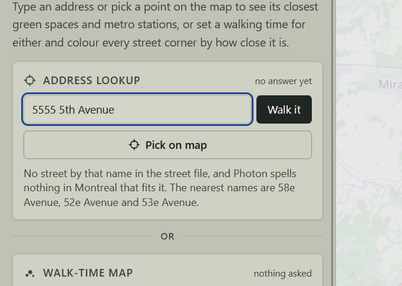
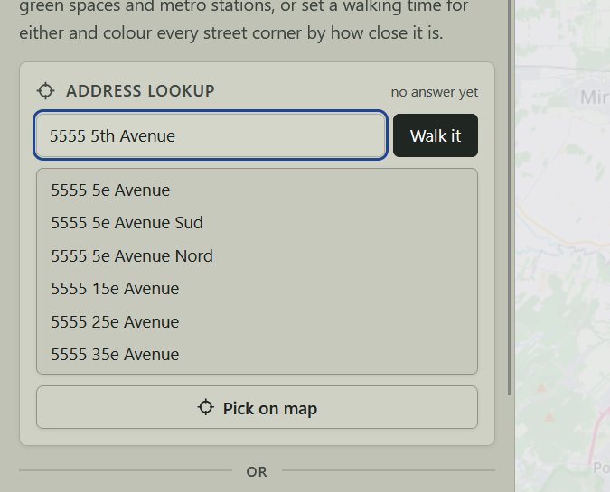

# Feature Walking Distance Map - Walking distance to Montreal's parks and metro stations

While we don't pick where we're born, we later in life get to pick where we'll live; this tool aims to make that process easier.

Currently, a prospective homebuyer or renter in the city of Montreal cannot easily have a visualization of the areas within the city that are within a reasonable walking distance of physical features that matters to them. This map tackles that by allowing to look-up addresses to see their proximity to parks and metro stations, along with displaying a proximity dot map for the entirety of the city.

## About

This site was created in the context of an AI-assisted programming geography class, GEOG 464.

The map covers all boroughs of the city of Montreal, meaning it excludes the independent municipalities that are greyed out.

All data comes from public sources, converted to GeoJSONs, and drawn with LeafletJS.

The data is first fetched from public sources, after which it is cleaned and turned into GeoJSONs with metro points, green space polygons, borough outlines, and street corners with their walk times.

## Using the site

The site is live at <https://alluvial-fan.github.io/fwdm/>. It needs no account and no installation, the page reads its own GeoJSON from `site/data/` and its tiles from OpenStreetMap.

To run it locally, clone the repository and open [site/index.html](site/index.html) with [Live Server](https://marketplace.visualstudio.com/items?itemName=ritwickdey.LiveServer) in VS Code or VSCodium. Running the raw HTML file directly will not open the site's data, and the site must be run online, since it requires data to be loaded in from LeafletJS and OpenStreetMap.

A reader can do three things:

- **Filter.** Parks, metros or both, with walk-time ranges, green spaces by types and size, and whether the metro entrance must be step-free; one button under the filters puts every menu back to n/a.
- **Pick on map.** Press the "Pick on Map" button, then click a spot to measure from there.
- **Type an address.** A house number and a street name; the page finds it and (assuming it's within the boundaries) measures from there.

### Limitations

Distances to metro stations are really distances to the entrance, meaning that actual distance from entrance to the platform will increase distance slightly and in an unequal fashion between each station. The street file only has "real" roads, meaning no shortcuts or pathways through parks or other public land will be calculated. It also assumes a constant walking speed and doesn't take into consideration construction or walking up hills or being stopped at traffic lights. Some street types (class 8, motorways) are ignored across the board as they SHOULD all be expressways pedestrians cannot walk on. Two of Vendôme's four entrances (M70/M71) are not attached to the street network; the station is still reachable through its other two entrances.


## Timeline

At the start of the project, the goal is for the core action a user, a prospective Montreal renter or buyer, must be able to do, is to be able to see which street corners are within a chosen walking time of the parks and/or metro stations they care about.

### MoSCoW statement (project start)

A user on my site must:
- Be able to see where parks and metro stations are.
- Be able to see which street corners are within walking distance of the features they choose.
- Be able to tell which areas are farther away than the time they set (e.g. 15 minutes).

A user on my site should:
- Be able to specify the type of green space and the kind of metro entrance they are interested in.
- Be able to see extra data about each feature when they click it.

A user on my site could (in a later iteration):
- Add food stores as a third feature type.

My project does not, and will not (this term):
- Cover the whole island (the independent municipalities).
- Add significantly more feature types or finer filter options.

### Not in this iteration (before A2)

While I have the data for non-Montreal municipalities on the island of Montreal, and I have data for an additional feature type (food stores), the project as it stands does not, and will not for the foreseeable future, include them. Doing so would require handling data taken from OpenStreetMap, which is user-submitted and would need significantly more checks and validation than the current pre-existing data straight from the source. The one thing I will build next is adding the food stores as a third feature.

### Initial testing (before A2)

A friend tested the build I was preparing for A2, and they found that when refreshing the page, the map and what was visible on it were reset with exceptiong for the filter selections. This meant the map was now blank but filter had options selected. I resolved this by adding a check which makes sure the map displays what the filters are set at.

### Five-second test (during A2 week)

I opened the map to the metro-only layer and had a classmate take 5 seconds to look at it and tell me what they saw and understood. They said 
```
The map (based on title) talks about looking at walking distance to green spaces. From looking at it in 5 seconds, I cannot tell what the different colours mean.
``` 
Based on this, I worked at improving the legibility and the information which is presented to the user on the screen along with a graphical legend describing the colors.

### Post-demo thoughts

During the MVP demo, the one thing I could accurately explain is how the dots are colored when both the park and metro filters are active.

The one thing I want to fix with my code is simplifying it. It works and I can "understand" what happens, but it's fairly heavy and I think there'd be a way to make it lighter.

### A3 feature: address lookup

For A3, I will add the ability to lookup addresses in the city, so that my reader can upon lookup, see the 3 closest parks and 2 closest metro stations with a drawn walking path on the map. It has depth because compared to the existing point data, it live computes distances for a new feature, which the MVP version didn't. I will know it works when I'm able to either click on the map or lookup an address, and it shows me the closest metro stations and parks with a line drawn on the streets.

My edge case is when the address is either not recognized, or no calculations for walking distances can be calculated map.

#### Lab 7 testing of A3 feature

| Test | Expected | What actually happens |
| --- | --- | --- |
| I enter an address in the search bar. | It selects it and maps the closest metro/parks(1 for each type/size) and it maps the walking path. | It selects that point, draws the paths to the closest 3 parks and metro stations with information in the sidebar on how long it takes to get to each of these points. |
| I choose the "selector mode" and I click somewhere on the map. | It identifies the closest physical address, and maps the closest metro/parks and walking paths. | There is no selector mode, but you can just click anywhere and it will calculate the closest parks and points based on where you clicked. It does not tell you the closest address to where you are since it does not need that. |
| I choose an address which isn't on the island of Montreal/out of bounds. | An error message lets me know the address was not found/out of bounds. | I get this error message: That spot is outside the 19 boroughs this map covers, so the page measures nothing there. |

### Pre-flight report (Lab 7)

| Check | Result | What I did |
| --- | --- | --- |
| 1. Cold start | Pass. | n/a |
| 2. Read every label | Fail: I had the following errors: `app.js:835 [Violation] 'change' handler took 183ms` | Currently every street corner is it's own marker and the page was loading all of them so the handler didn't return until all 19k were drawn. Changed the dot drawing behavior so dots appear 2k at a time and handler returns immediately. |
| 3. Ask twice | Pass. Works. | n/a |
| 4. The edge | Pass. Message appears saying "That spot is outside the 19 boroughs this map covers, so the page measures nothing there." | n/a |
| 5. The data does not come | Pass/Fail. | Nothing happened and an error message appeared but it was ambiguous as to what was failing. Made it so that the error message is specific about what is missing. |
| 6. On a phone (size view and my phone) | Fail. Works but the sidebar which on mobile is at the top doesn't hide and takes most of the screen | Made it so that when you're on phone mode (when the sidebar becomes the top bar), it ads a "Filters" button that toggles view on the filters. |
| 7. Mouse in my pocket | Pass. | n/a |
| 8. Accessibility audit | Fail. | Added accessible names to the filters, made the left bar the page's main landmark so it stops complaining we don't have a main landmark. |

### A3 Part 3: What I found, and one fix
- Evidence: On being given the instructions to lookup “5555 5e Avenue”, they looked up “5555 5th Avenue” or “5555 5 Avenue” which the lookup search tool didn’t understand and told them the address didn’t exist. [Round 1 and 2]
- Severity: 3, stops the user from being able to use the search feature to find the address they're looking for.
- My change: Added a dropdown to the street name search using Fuse.js to provide suggestions based on the street name file.
- Recheck: One of the two class TAs tested the feature. Upon retrying the same address that caused issues it worked. 
  - Fixed means: They do it without hesitating at that spot.

Before:



After: 



The fix spans several files and several sections of the code, but the main sections are found in `site\app.js`, from lines 2107 to 2358. When you pause in typing, a street names json is downloaded in the background. From that, fuse (ignoring the house number) will attempt to match similarities and returns 40 closest matches. From that, it creates the dropdown list. What I don't fully yet understand is how fuse.js works. It was recommended to me by a TA and I understand what it does, but not the intricacies of how it works.

## AI Disclosure

This project (A2 and A3) was built with the help of AI coding models. Primiarly, it used DeepSeek's `V4.X Flash` and `V4 Pro` models within my IDE. I used it first as a brainstorming aid for the walk-time calculation, then gave it small, specific steps: turn the raw data into GeoJSON, keep only the fields the map reads, draw the result, repeat.

It often needed several tries to understand the scope I wanted, and it hallucinated instructions when I asked it to limit what it processed. For every answer I checked it was solving the right problem, then opened the page in Live Server to confirm the map did what I expected, and committed each stage I trusted so there was always a fallback. The main dead end was drawing a polygon for every city block; I rejected that for static street corners, which were simpler to calculate and to draw.

The problem, the audience, the core action, and every decision to accept, change or reject what the agent produced stayed mine.

As the project progressed, I got better at giving it instructions to make sure it only covered what I was asking for, though I'd still have to be careful as it would often try to do more.

At a lesser level, Github Copilot was used for commit summaries.

## Data sources

### Metro stops — STM GTFS

Taken from the STM developer homepage ([www.stm.info/en/about/developers](https://www.stm.info/en/about/developers)).

**Licence:** CC BY 4.0 (https://www.stm.info/en/about/developers/terms-use).

<details>

File URL: [www.stm.info/sites/default/files/gtfs/gtfs_stm.zip](https://www.stm.info/sites/default/files/gtfs/gtfs_stm.zip)

Within `gtfs_stm.zip` lies `stops.txt`, a file which contains the location data for the STM's metro and bus stops.

</details>

### Green spaces — Ville de Montréal

Taken from the Montreal City's open data portal ([donnees.montreal.ca/fr/dataset/grands-parcs-parcs-d-arrondissements-et-espaces-publics](https://donnees.montreal.ca/fr/dataset/grands-parcs-parcs-d-arrondissements-et-espaces-publics)).

**Licence:** CC BY 4.0 (https://donnees.montreal.ca/pages/licence-d-utilisation).

<details>

Data available as CSV, JSON and SHP files; we'll be using the JSON `espace_vert.json` as it doesn't require extra processing.

| Type | URL |
| --- | --- |
| JSON | [donnees.montreal.ca/dataset/2e9e4d2f-173a-4c3d-a5e3-565d79baa27d/resource/35796624-15df-4503-a569-797665f8768e/download/espace_vert.json](https://donnees.montreal.ca/dataset/2e9e4d2f-173a-4c3d-a5e3-565d79baa27d/resource/35796624-15df-4503-a569-797665f8768e/download/espace_vert.json) |

</details>

### Borough outlines — Ville de Montréal

Taken from the Montreal City's open data portal ([donnees.montreal.ca/fr/dataset/limites-administratives-agglomeration](https://donnees.montreal.ca/fr/dataset/limites-administratives-agglomeration)).

**Licence:** CC BY 4.0 (https://donnees.montreal.ca/pages/licence-d-utilisation).

<details>

Two formats, GeoJSON and SHP, each in NAD83/MTM zone 8 and WGS 84 (four files).

| Type | URL |
| --- | --- |
| GeoJSON (NAD83/MTM zone 8) | [donnees.montreal.ca/dataset/9797a946-9da8-41ec-8815-f6b276dec7e9/resource/6b313375-d9bc-4dc3-af8e-ceae3762ae6e/download/limites-administratives-agglomeration-nad83.geojson](https://donnees.montreal.ca/dataset/9797a946-9da8-41ec-8815-f6b276dec7e9/resource/6b313375-d9bc-4dc3-af8e-ceae3762ae6e/download/limites-administratives-agglomeration-nad83.geojson) |
| SHP (NAD83/MTM zone 8) | [donnees.montreal.ca/dataset/9797a946-9da8-41ec-8815-f6b276dec7e9/resource/e8bea324-044c-4544-bbd1-2e0d08a24216/download/limites-administratives-agglomeration-nad83.zip](https://donnees.montreal.ca/dataset/9797a946-9da8-41ec-8815-f6b276dec7e9/resource/e8bea324-044c-4544-bbd1-2e0d08a24216/download/limites-administratives-agglomeration-nad83.zip) |
| GeoJSON (WGS84) | [donnees.montreal.ca/dataset/9797a946-9da8-41ec-8815-f6b276dec7e9/resource/e18bfd07-edc8-4ce8-8a5a-3b617662a794/download/limites-administratives-agglomeration.geojson](https://donnees.montreal.ca/dataset/9797a946-9da8-41ec-8815-f6b276dec7e9/resource/e18bfd07-edc8-4ce8-8a5a-3b617662a794/download/limites-administratives-agglomeration.geojson) |
| SHP (WGS84) | [donnees.montreal.ca/dataset/9797a946-9da8-41ec-8815-f6b276dec7e9/resource/93385165-d849-418f-aaa3-0497ed9e4702/download/limites-administratives-agglomeration.zip](https://donnees.montreal.ca/dataset/9797a946-9da8-41ec-8815-f6b276dec7e9/resource/93385165-d849-418f-aaa3-0497ed9e4702/download/limites-administratives-agglomeration.zip) |

</details>

### Street network — Ville de Montréal (Géobase)

Taken from the Montreal City's open data portal ([donnees.montreal.ca/dataset/geobase](https://donnees.montreal.ca/dataset/geobase)).

**Licence:** CC BY 4.0 (https://donnees.montreal.ca/pages/licence-d-utilisation).

<details>

Three files, a CSV, a ZIP, and a GeoJSON.

| File | URL |
| --- | --- |
| CSV | [donnees.montreal.ca/dataset/984f7a68-ab34-4092-9204-4bdfcca767c5/resource/cdf491fa-bf3d-4eb1-8692-c9aa1df462cd/download/geobase.csv](https://donnees.montreal.ca/dataset/984f7a68-ab34-4092-9204-4bdfcca767c5/resource/cdf491fa-bf3d-4eb1-8692-c9aa1df462cd/download/geobase.csv) |
| ZIP | [donnees.montreal.ca/dataset/984f7a68-ab34-4092-9204-4bdfcca767c5/resource/70c1f8c7-91a0-4553-b602-89c3edb959b5/download/geobase.zip](https://donnees.montreal.ca/dataset/984f7a68-ab34-4092-9204-4bdfcca767c5/resource/70c1f8c7-91a0-4553-b602-89c3edb959b5/download/geobase.zip) |
| GeoJSON | [donnees.montreal.ca/dataset/984f7a68-ab34-4092-9204-4bdfcca767c5/resource/9d3d60d8-4e7f-493e-8d6a-dcd040319d8d/download/geobase.json](https://donnees.montreal.ca/dataset/984f7a68-ab34-4092-9204-4bdfcca767c5/resource/9d3d60d8-4e7f-493e-8d6a-dcd040319d8d/download/geobase.json) |

</details>

### Food stores — OpenStreetMap (downloaded for a later feature, not used yet)

Taken from OpenStreetMap using the Overpass Turbo API ([overpass-turbo.eu/](https://overpass-turbo.eu/)).

**Licence:** ODbL (https://www.openstreetmap.org/copyright).

<details>

Fetches all `supermarkets`, `convenience stores`, `frozen food` stores, and `greengrocers` within what OSM identifies as Montreal.

```
/*
This has been generated by the overpass-turbo wizard.
The original search was:
“(shop=supermarket or shop=convenience or shop=frozen_food or shop=greengrocer) in Montreal”
*/
[out:json][timeout:25];
// fetch area “Montreal” to search in
{{geocodeArea:Montreal}}->.searchArea;
// gather results
(
  nwr["shop"="supermarket"](area.searchArea);
  nwr["shop"="convenience"](area.searchArea);
  nwr["shop"="frozen_food"](area.searchArea);
  nwr["shop"="greengrocer"](area.searchArea);
);
// print results
out geom;
```

</details>